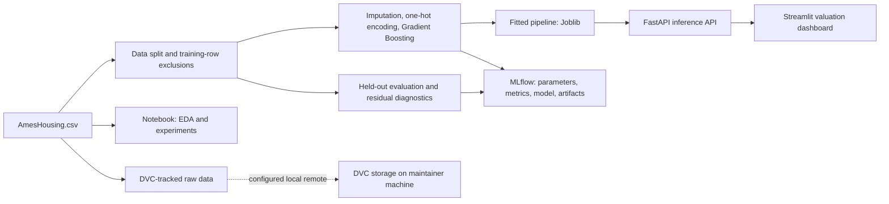

# Ames Housing Price Prediction

An end-to-end machine learning project for estimating residential sale prices from property characteristics in the historical Ames Housing dataset. The repository includes exploratory analysis, a reproducible scikit-learn training pipeline, MLflow tracking, DVC data tracking, a FastAPI inference service, a Streamlit valuation dashboard, Docker packaging, and automated tests in GitHub Actions.

## Project overview

The project addresses a regression problem: given a home's recorded characteristics, estimate its `SalePrice`. The work moves from data quality investigation and exploratory analysis to model comparison, tuning, error analysis, interpretation, and an inference interface for analysts.

The notebook contains the exploratory and model-selection experiments. The Python package contains the reusable data, preprocessing, training, evaluation, and inference code. A fitted Gradient Boosting pipeline is checked in at `models/gradient_boosting_pipeline.joblib` so the API and dashboard can run without training first.

## Key capabilities

- Explore the dataset and investigate missing-value patterns and unusual observations.
- Split data reproducibly and exclude two suspected anomalous rows from training only.
- Impute numeric and categorical values and one-hot encode categorical features in a scikit-learn pipeline.
- Compare regression baselines, tune Random Forest and Gradient Boosting with cross-validation, and evaluate on a held-out test set.
- Track parameters, metrics, the fitted model, diagnostic plots, and large-error examples with MLflow.
- Version the raw CSV with DVC.
- Predict one or many properties through FastAPI, with a schema endpoint for clients.
- Upload a property CSV to the Streamlit dashboard, inspect valuation summaries, and download predictions.
- Run the API and dashboard together with Docker Compose.

## Architecture



## Repository structure

```text
.
├── app/
│   └── streamlit_app.py              # Analyst-facing batch valuation UI
├── data/raw/
│   └── AmesHousing.csv.dvc           # DVC pointer; CSV itself is not in Git
├── models/
│   └── gradient_boosting_pipeline.joblib
├── notebooks/
│   └── 01_ames_house_price_experimentation.ipynb
├── src/housing/
│   ├── api.py                        # FastAPI routes and request models
│   ├── config.py                     # Paths, split, model parameters, CV score
│   ├── data.py                       # Load, split, and exclude training rows
│   ├── evaluate.py                   # Metrics, plots, and error analysis
│   ├── experiment_tracking.py        # MLflow tracking configuration
│   ├── predict.py                    # Model loading and input validation
│   ├── preprocessing.py              # Imputation and categorical encoding
│   └── train.py                      # Pipeline fitting and artifact logging
├── tests/                            # Pytest unit tests
├── .github/workflows/ci.yml          # GitHub Actions test workflow
├── docker-compose.yml
├── Dockerfile.api
├── Dockerfile.streamlit
├── pyproject.toml
└── requirements.txt
```

## Dataset

The project uses the Ames Housing dataset, with **2,930 observations and 82 original columns**. `SalePrice` is the target; the remaining columns describe property, location, quality, and sale characteristics. The notebook investigates missingness, duplicates, target distribution, feature distributions, and relationships between property attributes and sale prices.

The modeling code removes `SalePrice`, the identifier columns `Order` and `PID`, and `LogSalePrice` if that notebook-derived column is present. The input pipeline then uses the remaining property features. The API's `GET /schema` route returns the exact required feature names for the fitted model.

The CSV is not committed to Git. The repository includes a DVC pointer for `data/raw/AmesHousing.csv`; see [DVC data versioning](#dvc-data-versioning) for the current remote limitation and retrieval options.

## Machine learning methodology

1. **Explore and assess quality.** The notebook examines missing values, unusual records, identifiers, price distributions, and feature-price relationships. Some missing categorical values appear to represent absent property features, so the model uses an explicit missing category rather than trying to infer every absence during EDA.
2. **Split the data.** `train_test_split` reserves 20% for testing with `random_state=42`. The test rows remain unchanged during the training-row sensitivity experiment.
3. **Exclude selected training rows.** Rows with original DataFrame indices `1498` and `2180` were identified as highly influential examples with very large living areas and unusually low sale prices for their recorded characteristics. They are excluded from training when present in the training split; they are not removed from the source dataset or test split.
4. **Preprocess within a pipeline.** Numeric columns receive median imputation. Categorical columns receive constant imputation with `Missing`, then one-hot encoding with `handle_unknown="ignore"`. `MS SubClass` is treated as categorical even though it is stored numerically. Preprocessing is fitted as part of the model pipeline.
5. **Compare and tune.** The notebook compares a mean Dummy Regressor, Linear Regression, Ridge, Random Forest, and Gradient Boosting using shuffled five-fold cross-validation (`random_state=42`). It then runs randomized searches over 20 configurations each for Random Forest and Gradient Boosting, using five-fold CV and RMSE as the selection metric.
6. **Evaluate and inspect errors.** The selected Gradient Boosting model is assessed on the held-out test set using MAE, RMSE, and R². The evaluation code also creates actual-versus-predicted and residual plots and logs the 15 largest absolute errors.

The fitted model is a scikit-learn `Pipeline` containing a `ColumnTransformer` and `GradientBoostingRegressor`. Its configured parameters include 363 estimators, learning rate 0.06156, maximum depth 4, and `random_state=42`.

## Model comparison and evaluation

The notebook's initial five-fold CV comparison is shown below. These are baseline results before excluding the two influential training observations or running hyperparameter search.

| Baseline model | Mean CV RMSE |
|---|---:|
| Dummy Regressor | $77,086.27 |
| Linear Regression | $30,664.24 |
| Ridge | $33,152.94 |
| Random Forest | $26,570.44 |
| Gradient Boosting | **$26,222.30** |

After excluding the two selected training rows, randomized search produced these best five-fold CV RMSE values:

| Tuned model | Best CV RMSE |
|---|---:|
| Random Forest | $24,962.67 |
| Gradient Boosting | **$20,619.12** |

The final Gradient Boosting model's reported test results are:

| Test metric | Result |
|---|---:|
| MAE | $13,969.87 |
| RMSE | $28,864.29 |
| R² | 0.896 |

The test R² indicates that the model explains about 89.6% of the variation in sale prices in this particular test split. Its test RMSE is higher than its best CV RMSE, so the CV score should not be read as a guarantee of test or future performance. The notebook's residual analysis also shows a wider spread of residuals at higher predicted prices.

## Feature importance and interpretation

The notebook computes permutation importance on the held-out test data using ten repeats and RMSE scoring. The mean values below are the increase in RMSE after a feature is shuffled; they summarize how much the fitted model relies on each feature for predictive accuracy in this evaluation.

| Feature | Mean increase in RMSE |
|---|---:|
| Overall Qual | $20,256.11 |
| Gr Liv Area | $10,090.24 |
| Total Bsmt SF | $1,496.21 |
| Year Built | $1,324.29 |
| BsmtFin SF 1 | $1,188.13 |

Overall Quality and above-ground living area are the strongest signals in this fitted model. Feature importance describes **predictive contribution, not causation**; it does not show that changing a feature would cause a corresponding change in a home's sale price.

## MLflow experiment tracking

The training and evaluation scripts use the experiment `ames-house-price-prediction` and configure the tracking URI as `http://127.0.0.1:5000`. Training logs model parameters, sample and feature counts, the recorded best CV RMSE, and the fitted scikit-learn model. Evaluation logs test metrics, actual-versus-predicted and residual diagnostic plots, and a CSV of the 15 largest test errors.

Start a local MLflow server from the repository root before running the training or evaluation modules:

```bash
mlflow server \
  --host 127.0.0.1 \
  --port 5000 \
  --backend-store-uri sqlite:///mlflow.db \
  --default-artifact-root ./mlartifacts
```

Open <http://127.0.0.1:5000> to browse runs. The `mlflow_demo.py` script logs illustrative historical values for a demonstration run; use `housing.train` and `housing.evaluate` for the project workflow.

## DVC data versioning

`data/raw/AmesHousing.csv.dvc` records the expected dataset hash and size, while the CSV is ignored by Git. The current `.dvc/config` points the default remote named `localstorage` to `D:\DVCStorage\ames-housing`. This is a local path on the maintainer's machine, not a shared or hosted remote, so cloning the repository does not let external users retrieve the CSV with `dvc pull`.

To use DVC, install it separately (`dvc` is not listed in `requirements.txt`). Then either configure a remote you can access and pull the tracked file:

```bash
python -m pip install dvc
dvc remote add --default storage <your-dvc-remote-url>
dvc pull data/raw/AmesHousing.csv
```

Or obtain the dataset separately and place it at `data/raw/AmesHousing.csv`, the path expected by the training code. A separately obtained file may not match the DVC hash recorded in this repository.

## FastAPI prediction service

The API loads the checked-in model once at startup. It validates that prediction input contains every model feature and no unexpected columns; `GET /schema` exposes the required feature list and count. The interactive OpenAPI documentation is available at `/docs`.

| Method | Route | Purpose |
|---|---|---|
| `GET` | `/` | Service name and docs path |
| `GET` | `/health` | Health status and model-loaded flag |
| `GET` | `/schema` | Required model features and feature count |
| `POST` | `/predict` | Predict one property from `{"features": {...}}` |
| `POST` | `/predict/batch` | Predict properties from `{"records": [{...}, ...]}` |

Start the API locally with `uvicorn housing.api:app --reload --host 127.0.0.1 --port 8000`. For a valid request example, build the payload from a row in the dataset so it includes the complete model schema:

```python
import json

import pandas as pd
import requests

df = pd.read_csv("data/raw/AmesHousing.csv")
features = df.drop(
    columns=["SalePrice", "Order", "PID", "LogSalePrice"],
    errors="ignore",
)
row = json.loads(features.iloc[[0]].to_json(orient="records"))[0]

response = requests.post(
    "http://127.0.0.1:8000/predict",
    json={"features": row},
    timeout=30,
)
response.raise_for_status()
print(response.json())  # {"predicted_price": ...}
```

For batch prediction, send a non-empty list of complete records:

```python
records = json.loads(features.iloc[:3].to_json(orient="records"))
response = requests.post(
    "http://127.0.0.1:8000/predict/batch",
    json={"records": records},
    timeout=120,
)
response.raise_for_status()
print(response.json())  # {"predictions": [...], "total_properties": 3}
```

## Streamlit valuation dashboard

The dashboard at `app/streamlit_app.py` is designed for analysts who want to value a batch of properties. It checks API health, accepts a CSV upload, fetches the model schema, reports missing required columns and ignores extra columns, then sends valid records to the batch endpoint. Results include property-level estimates, count/mean/median/total summary metrics, a predicted-price histogram and boxplot, and a downloadable CSV.

Run the API first, then start the dashboard in another terminal:

```bash
streamlit run app/streamlit_app.py
```

The dashboard defaults to `http://127.0.0.1:8000` for the API. Set `API_URL` if the API runs at another address.

## Docker and Docker Compose

The API and Streamlit app have separate Dockerfiles, both based on `python:3.14-slim`. The API image copies in the fitted model. Compose sets `API_URL=http://api:8000` for the dashboard and publishes ports 8000 and 8501.

Build and start both services from the repository root:

```bash
docker compose up --build
```

- Dashboard: <http://localhost:8501>
- API docs: <http://localhost:8000/docs>
- API health: <http://localhost:8000/health>

Stop the services with `docker compose down`. The Compose configuration runs inference services; it does not start MLflow or train the model.

## Installation, testing, and CI

The package metadata declares Python `>=3.10`; the current requirements, Docker images, and GitHub Actions workflow are aligned to Python 3.14, which is recommended for this setup. From the repository root, create an environment and install the application dependencies:

```bash
python -m venv .venv
```

Activate it in PowerShell:

```powershell
.venv\Scripts\Activate.ps1
```

Or in macOS/Linux:

```bash
source .venv/bin/activate
```

Then install and run the unit tests:

```bash
python -m pip install -r requirements.txt
python -m pip install -e .
pytest -v
```

The tests cover data loading and splitting, preservation of test rows during training exclusions, preprocessing of missing and unseen values, model fitting and save/load behavior, prediction input validation, and evaluation metrics. GitHub Actions runs `pytest -v` on pushes and pull requests targeting `main`, using Python 3.14. The workflow installs requirements and the editable package; it does not run model training or Docker builds.

For local model development, ensure the dataset is available and an MLflow server is running, then execute:

```bash
python -m housing.train
python -m housing.evaluate
```

Training saves the fitted pipeline to `models/gradient_boosting_pipeline.joblib`; evaluation loads that artifact and evaluates the held-out test split. The recorded best CV score is stored in `src/housing/config.py`; running the training module does not repeat the notebook's randomized hyperparameter search.

## Limitations and future improvements

- This is a historical Ames dataset and a fixed random train/test evaluation. The model is **not automatically suitable for real-world valuation or deployment** without validation on current, relevant data and a defined operational use case.
- Residuals spread out more at higher predicted prices, and some expensive or unusual properties have large errors. Evaluate error by price band and property segment, and consider approaches that improve performance at the high end.
- Two influential rows are excluded from training based on a sensitivity analysis, although their unusual characteristics do not by themselves prove that the records are erroneous. Revisit this decision with domain review and robust-model comparisons.
- The test result comes from one split; additional temporal, geographic, and external validation would better characterize generalization.
- Useful next experiments include target transformations, alternative boosting implementations, richer feature engineering, uncertainty estimates, and monitoring for data and prediction drift.
